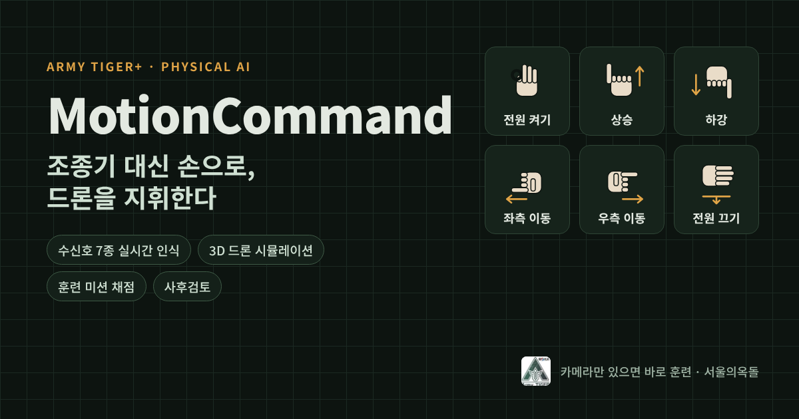

# MotionCommand

카메라로 손 수신호를 인식해 드론을 조종하는 **제스처 기반 드론 통제 훈련체계**입니다.
Army TIGER+ 유무인복합전투를 위한 Physical AI 시제품으로, 실기체 없이 3D 시뮬레이션으로 훈련하고 기록을 사후검토합니다.

**체험하기: https://motioncommand.vercel.app**



## 주요 기능

| 화면 | 내용 |
|---|---|
| ① 체계 소개 | Army TIGER+ 정책, 본 체계와의 연계성, 물리 조종기 vs 제스처 비교, 발전 단계 |
| ② 환경설정·조작법 | 브라우저·HTTPS·카메라·권한·AI 모델·저장소 자동 점검, 브라우저별 권한 안내, 수신호 7종 카드, 매뉴얼 PDF |
| ③ 조작 시뮬레이션 | 카메라 손 관절 21점 실시간 인식, 3D 드론, 훈련 미션 4종 채점, 화면 버튼·키보드 백업 입력 |
| ④ 사후검토 | 개인: 점수 추이·과제별 성공률·잘못된 습관 Top 3 / 교관: 전체 현황·실수 분포·CSV 내보내기·가져오기 |
| ⑤ 관련 정보 | 포즈 추정 이론, MediaPipe Hands 구조, 실제 분류 규칙, 드론 지식, 관련 법령 링크 |
| ⑥ 제작자 정보 | 서울의옥돌(京珉), 주요 발표 논문 4편, 문의 안내 |

수신호: OK(전원 켜기) · 엄지척(상승) · 엄지 아래(하강) · 검지 좌/우(이동) · 손바닥 아래(전원 끄기, 공중이면 자동 착륙) · 손 빼기(정지)

## 폴더 구조

```
index.html            화면 6개
css/style.css         스타일 (라이트/다크)
js/config.js          ★ Supabase 키 설정
js/gestures.js        손 관절 → 수신호 규칙 분류기, 유지 시간 필터
js/hands-svg.js       수신호 그림, 관절 21점 도식
js/sim.js             카메라·MediaPipe, 3D 드론(Three.js), 미션 채점
js/store.js           기록 저장 (Supabase 또는 이 기기), CSV
js/review.js          사후검토 차트·습관 분석
js/app.js             화면 전환, 환경 점검, 매뉴얼
supabase/schema.sql   기록 테이블 + 보안 정책
assets/               엠블럼, 썸네일, 스크린샷
docs/PRD.md           제품 요구사항 문서
docs/GALLERY.md       갤러리 등록 문안
```

빌드 과정이 없는 정적 사이트입니다. 라이브러리(Three.js, MediaPipe, supabase-js)는 브라우저가 CDN에서 불러옵니다.

## 배포 (GitHub → Vercel → Supabase)

### 1. GitHub에 올리기
1. github.com에서 **New repository** → 이름 `motioncommand` → Public → Create
2. 저장소 화면에서 **uploading an existing file** 클릭 → 이 폴더 안의 파일과 폴더를 전부 끌어다 놓기 → **Commit changes**

### 2. Supabase 기록 DB 만들기
1. supabase.com → **New project** (리전: Northeast Asia (Seoul))
2. 왼쪽 **SQL Editor** → `supabase/schema.sql` 내용을 붙여넣고 **Run**
3. **Project Settings → API**에서 `Project URL`과 `anon public` 키 복사
4. GitHub에서 `js/config.js` 편집 → 두 값 입력 → Commit
   ```js
   SUPABASE_URL: 'https://xxxx.supabase.co',
   SUPABASE_ANON_KEY: 'eyJhbGciOi...',
   ```
   `service_role` 키는 절대 넣지 마세요. anon 키는 공개돼도 되는 키이고, 권한은 schema.sql의 RLS 정책(추가·조회만 허용)으로 제한됩니다.

### 3. Vercel 배포
1. vercel.com → GitHub로 로그인 → **Add New → Project** → `motioncommand` 저장소 **Import**
2. Framework Preset: **Other**, Build Command 비움, Output Directory 비움 → **Deploy**
3. 발급된 `https://motioncommand-xxxx.vercel.app` 주소로 접속
4. 이후 GitHub에 커밋하면 자동으로 다시 배포됩니다.

### 4. 확인
- ② 환경설정 화면에서 7개 항목이 모두 초록색인지 확인
- "기록 저장소"가 `공유 저장소(Supabase) 연결`로 나오면 성공
- ③에서 M1을 한 번 수행 → ④ 교관 탭에 기록이 보이면 완료

## 로컬에서 실행

카메라는 `https://` 또는 `http://localhost`에서만 동작합니다.

```bash
python3 -m http.server 8000
# 브라우저에서 http://localhost:8000
```

## 개인정보·보안

- 카메라 영상은 브라우저 안에서만 처리하며 서버로 보내거나 저장하지 않습니다.
- 저장하는 정보는 계급, 이름(또는 훈련번호), 점수, 실수 횟수뿐입니다. 군번·소속은 받지 않습니다.
- 연구·교육용 시제품이며 실제 무기체계나 공식 교범이 아닙니다.

## 문의

서울의옥돌 · seouljade@kma.ac.kr
